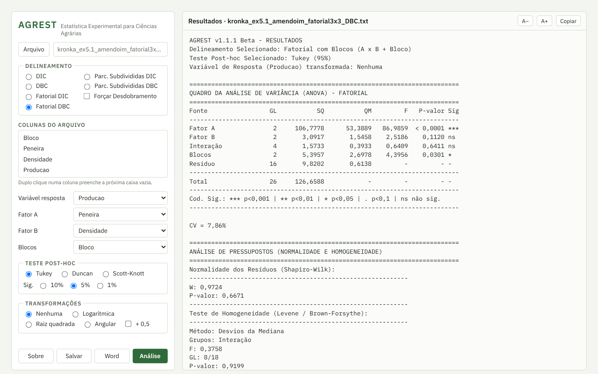

# AGREST

**Estatística Experimental para Ciências Agrárias**

O AGREST faz análise de variância (ANOVA) e testes de comparação de médias para experimentos agrícolas e florestais. Ele roda direto no navegador: não precisa instalar nada, e os dados não saem do seu computador.

### ▶ [Abrir o AGREST](https://alyssonx.github.io/AGREST/)

## O que ele faz

- **Delineamentos:** inteiramente casualizado (DIC), blocos casualizados (DBC), fatorial em DIC e em DBC, parcelas subdivididas em DIC e em DBC
- **Testes de médias:** Tukey, Duncan e Scott-Knott, a 10%, 5% ou 1%
- **Pressupostos:** normalidade dos resíduos (Shapiro-Wilk) e homogeneidade das variâncias (Bartlett e Levene)
- **Transformações:** logarítmica, raiz quadrada e angular (arco-seno), com a opção + 0,5
- **Dados desbalanceados:** ANOVA por mínimos quadrados (SQ Tipo III) e médias ajustadas
- **Desdobramento** da interação nos fatoriais
- **Arquivos:** abre .txt, .csv e .xlsx e exporta as tabelas para o Word (.docx)

## Como usar

1. Clique em **Arquivo** e escolha a planilha. A primeira linha deve ter o nome das colunas e cada linha seguinte, uma parcela.
2. Escolha o **delineamento**.
3. Dê um duplo clique nas colunas para preencher as caixas: variável resposta, tratamentos (ou fatores) e blocos.
4. Escolha o teste de médias e clique em **Análise**.

📺 Vídeo tutorial: https://youtu.be/BLtjQa6Yqto

## Validação

Os cálculos foram conferidos com o R e com os exemplos dos livros de Banzatto & Kronka (*Experimentação Agrícola*) e de Aleixo (*Estatística Experimental Aplicada às Ciências Florestais*).

## Autores

- Alysson Lívio Vasconcelos Guedes
- Borko Stosic
- José Domingos Albuquerque Aguiar
- Guilherme Pereira Evangelista Alves

Contato: alyssonx@gmail.com

## Como citar

GUEDES, A. L. V.; STOSIC, B.; AGUIAR, J. D. A.; ALVES, G. P. E. **AGREST: Estatística Experimental para Ciências Agrárias.** Versão 1.1.1. 2026. Disponível em: https://alyssonx.github.io/AGREST/

## Licença

Uso gratuito para fins acadêmicos, científicos e pessoais. É proibido modificar ou redistribuir. Veja os termos completos em [LICENSE](LICENSE).

© 2026 Os autores. Todos os direitos reservados.
